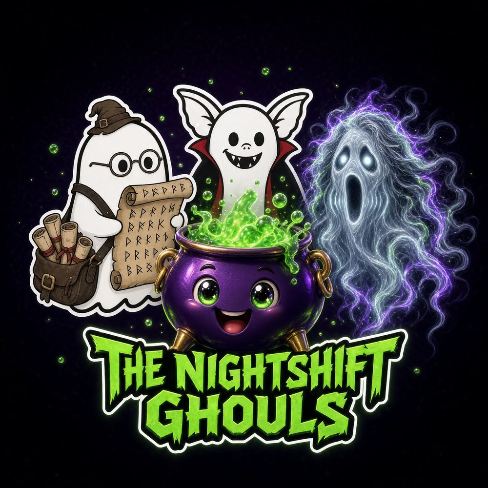

# nightshift-ghouls

**THE NIGHTSHIFT GHOULS** — the AI bot team roster. Eight specialized agents, one lane
each, hard limits enforced, all output through GitHub (PRs, issues, checks).
Built on the static-spa v1.TW engine: zero backend, hash-routed, dark-only,
JetBrains Mono, ecto-green + spectre-violet.

**Pages:** Roster (`#/`) — stat row + eight profile cards (avatar, tagline,
lane, schedule, hard limits, reports channel) · Doctrine (`#/doctrine`) —
why the team works.

## Configure

Everything you edit lives in **`js/data.js`**:

| What | Where |
|---|---|
| Card content per bot (lane / schedule / limits / reports) | `BOTS` array — current text is DRAFT; overwrite with approved PR #1 card content |
| Why-the-team-works principles | `DOCTRINE` array |
| Masthead / footer text | `SITE` |
| Theme colors | `css/style.css` TOKENS block |
| Avatars | `assets/<slug>.jpg` (640px, pre-optimized) |
| Master logo (roster hero + README banner) | `assets/nightshift-ghouls-logo.jpg` |

Preview locally by opening `index.html` in a browser (no server needed —
the roster makes no fetch calls). Deploy: push + Settings → Pages →
`main` / root.

Formal README to follow from templates/PROJECT_README_TEMPLATE.md once card
content is final.
